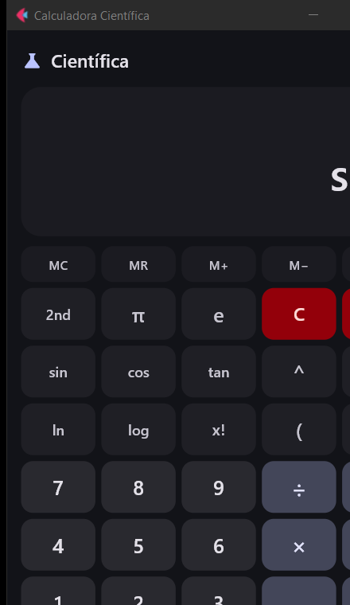

# Calculadora Científica

[](https://github.com/AurelioM20/Calculadora-Python/actions/workflows/ci.yml)
[](LICENSE)
[](https://github.com/AurelioM20/Calculadora-Python/releases/latest)

Calculadora científica em Python com **interface gráfica em Flet** e **modo
terminal (CLI)**. Os dois modos compartilham o mesmo motor de cálculo.

- `calculadora.py` — motor de cálculo + CLI
- `calculadora_ui.py` — interface gráfica (Flet)



## Recursos

- Operações básicas: `+ - × ÷ % ^`, parênteses e fatorial (`x!`)
- Potências e raízes: `√`, `∛`, `x^y`, `1/x`
- Trigonometria em **graus** ou **radianos**: `sin cos tan` e as inversas
  `sin⁻¹ cos⁻¹ tan⁻¹` (tecla **2nd**)
- Logaritmos e exponenciais: `log`, `ln`, `eˣ`, `10ˣ`
- Constantes: `π`, `e`, `EXP` (notação científica)
- Memória: `MC`, `MR`, `M+`, `M−` com indicador **M**
- Histórico de cálculos (clicável para reaproveitar o resultado)
- Multiplicação implícita: `2π`, `2(3+4)`
- Parênteses fechados automaticamente no `=`
- Suporte a teclado físico
- Mensagens de erro em português (divisão por zero, raiz de negativo, etc.)

## Requisitos

- Python 3.10+
- Flet 0.86.5

```bash
pip install -r requirements.txt
```

## Como executar

### Interface gráfica

```bash
python calculadora_ui.py
```

No Windows também dá para abrir com dois cliques em `abrir_calculadora.bat`.

### Terminal

```bash
python calculadora.py
```

Digite uma expressão e pressione Enter:

```
2 + 3 * 4
sin(30) + cos(60)
sqrt(81) / log(1000)
fact(5) + 2^10
3.5e-2 * 1e6
```

Comandos do terminal: `ajuda`, `modo`, `graus`/`deg`, `rad`/`radianos`,
`historico`/`hist`, `limpar`/`clear`, `m+`, `m-`, `mr`, `mc`, `sair`.

### App para Windows (.exe)

Baixe o zip da **[última release](https://github.com/AurelioM20/Calculadora-Python/releases/latest)**,
extraia em qualquer pasta e execute `Calculadora.exe`. Não precisa ter Python
instalado: o pacote já inclui o runtime do Flet e funciona offline.

> O executável não é assinado digitalmente. Na primeira abertura o Windows pode
> mostrar o SmartScreen — clique em **Mais informações → Executar assim mesmo**.

Para gerar o executável você mesmo:

```cmd
build_exe.bat
```

O resultado fica em `dist\Calculadora\Calculadora.exe` (`build/`, `dist/` e o
`.zip` gerado não entram no repositório).

## Atalhos de teclado (interface gráfica)

| Tecla | Ação |
|---|---|
| `0`–`9`, `.` e `,` | dígitos |
| `+` `-` `*` `/` `^` `%` | operadores |
| `Enter` | `=` |
| `Backspace` | apaga o último caractere |
| `Delete` / `Esc` | limpa tudo |
| `(` `)` | parênteses |
| `!` | fatorial |
| `F2` | alterna `2nd` |

## Estrutura

```
Calculadora-Python/
├── .github/
│   └── workflows/
│       └── ci.yml         testes automáticos no GitHub Actions
├── calculadora.py         motor de cálculo (AST seguro) + CLI
├── calculadora_ui.py      interface gráfica em Flet
├── abrir_calculadora.bat  atalho para rodar com Python
├── build_exe.bat          gera o executável do Windows
├── assets/
│   └── icone.ico          ícone do executável
├── docs/
│   └── calculadora.png    screenshot da interface
├── testes/
│   └── teste_calculadora.py  testes do motor (unittest)
├── LICENSE
├── requirements.txt
└── README.md
```

O motor usa `ast` para interpretar as expressões: nada de `eval`, ou seja, a
entrada do usuário não executa código arbitrário. Funções disponíveis no CLI:
`sin cos tan asin acos atan sinh cosh tanh sqrt cbrt raiz log ln log2 exp abs
round floor ceil fact hypot deg rad`, além das constantes `pi e tau phi inf
ans mem`.

## Testes

```bash
python -m unittest discover -s testes -v
```

O GitHub Actions roda esses testes a cada push na `main`, nas versões 3.10 e
3.13 do Python, além de compilar os dois módulos.

## Licença

Distribuído sob a licença [MIT](LICENSE).

